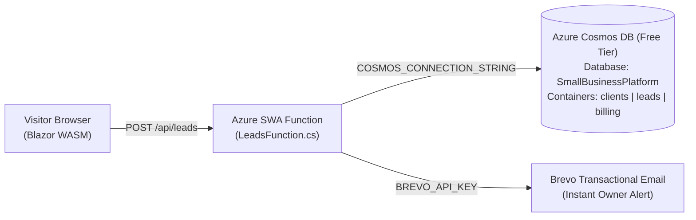

# Small Business Site Starter Template

A 100% configuration-driven **$0/month small business website, lead capture, and agency management platform** built with **Blazor WebAssembly (.NET 10)**, **Azure Static Web Apps Managed Functions (.NET 10)**, **Azure Cosmos DB (Multi-Tenant Free Tier)**, **Cloudflare Email Routing**, and **Brevo Transactional Email**.

---

## Architecture Overview



### Why This Stack?
1. **100% Config-Driven Frontend (`Client/wwwroot/appsettings.json`)**:
   * Brand colors (`PrimaryColor`, `AccentColor`, `SurfaceColor`, `BackgroundColor`), business contact info, hero copy, mission pillars, founder bio, service cards, and contact form dropdown options are all configured in a single JSON file—zero `.razor` or `.css` edits required to onboard a new client.
2. **All-in-Azure Database + Agency Backoffice (`Azure Cosmos DB` Free Forever Tier)**:
   * One free-tier Azure Cosmos DB account (`1,000 RU/s` throughput + `25 GB` storage free forever, **never pauses**) powers unlimited client websites inside the `SmallBusinessPlatform` database using 3 containers partitioned by `/businessId`:
     * **`clients`**: Master registry of client profiles, onboarding status, hosting/DNS links, billing plan tier, and full `appsettings.json` site configuration snapshots.
     * **`leads`**: All customer inquiries submitted via `POST /api/leads`.
     * **`billing`**: Tracks custom development charges, recurring plans, domain renewals, and invoice statuses for your Agency Portal.
3. **Instant Email Alerts via Brevo API**:
   * The `/api/leads` Azure Function automatically sends a formatted HTML inquiry alert to the business owner via Brevo's free API (`300 emails/day`), with `Reply-To` set to the customer's email address so the business owner can just hit **Reply** on their phone.
4. **$0/Month Infrastructure**:
   * **Hosting + Serverless API:** Azure Static Web Apps (Free Tier)
   * **Database:** Azure Cosmos DB Free Tier (25 GB + 1,000 RU/s shared across `clients`, `leads`, and `billing`)
   * **Inbound Email & DNS:** Cloudflare DNS + Email Routing (`info@clientdomain.com` → Owner's Gmail)
   * **Outbound Email & Lead Alerts:** Brevo Free Tier (`300 emails/day`)

---

## Repository Structure

* `Client/` — .NET 10 Blazor WebAssembly PWA
  * `wwwroot/appsettings.json` — Single-file configuration for branding, theme colors, pages, and intake options
  * `Models/SiteConfiguration.cs` — Strongly-typed configuration models
  * `Layout/MainLayout.razor` — Dynamic CSS variable injection + responsive header/footer
  * `Pages/` — Config-driven `Index.razor`, `About.razor`, `Services.razor`, and `Contact.razor`
* `Api/` — .NET 10 Isolated Azure Functions (Azure Static Web Apps Managed API)
  * `LeadsFunction.cs` — `POST /api/leads` endpoint with honeypot protection, native Cosmos DB REST insert (`leads`), verified recipient lookup (`clients`), and Brevo email alert
* `database/cosmos_schema.json` — Schema & sample documents for the `clients`, `leads`, and `billing` containers
* `scripts/`
  * `setup-cosmos.sh` — One-time Azure CLI script to provision your free-tier Cosmos DB account and `clients`, `leads`, and `billing` containers
  * `sync-client-config.py` — Automatically generates `index.html`, `sitemap.xml`, `robots.txt`, and `manifest.webmanifest` from `Client/wwwroot/appsettings.json` (also runs automatically in CI/CD)
  * `onboard-client.py` — Master CLI to onboard clients into Cosmos DB (`clients` + `billing`), configure Cloudflare DNS & Email Routing via API, verify Brevo domains, and view agency status
* `docs/CLIENT_ONBOARDING_PLAYBOOK.md` — End-to-end launch checklist & automation guide for onboarding new small business clients

---

---

## Project Requirement: Automated Client Onboarding & Portal Registration

> [!IMPORTANT]
> **Mandatory Agency Standard:** Every new client repository created from this template **must automatically be registered and added to the Agency Management Portal** ([https://purple-flower-020acac0f.4.azurestaticapps.net](https://purple-flower-020acac0f.4.azurestaticapps.net)). This guarantees immediate centralized lead tracking, Stripe subscription billing, and automated Azure/GitHub CI/CD provisioning from Day 1.

### Automated Workflow for New Clients:

1. **Create Repository:**
   * Click **"Use this template"** → **"Create a new repository"** on GitHub.
2. **Branding & Configuration:**
   * Place client logos/favicons in `Client/wwwroot/images/`.
   * Configure `Client/wwwroot/appsettings.json` (`BusinessSettings`, `ThemeSettings`, `HomePageSettings`, `AboutPageSettings`, `ServicesPageSettings`, `ContactPageSettings`).
3. **Automated Portal Registration & Infrastructure CLI:**
   * Run the master onboarding script to register the client with the live Agency Portal API, configure Cosmos DB, and set up Cloudflare DNS/Email Routing:
   ```bash
   python3 scripts/onboard-client.py onboard \
     --owner-name "<Owner Name>" \
     --owner-gmail "<owner@gmail.com>" \
     --plan "Managed Hosting & Support" \
     --rate 49
   ```
4. **1-Click Azure Provisioning via Portal:**
   * In the Agency Portal ([/clients](https://purple-flower-020acac0f.4.azurestaticapps.net/clients)), click **"Provision Infrastructure"** for the new client. The portal automatically:
     * Creates Azure Static Web App (`swa-<businessId>`)
     * Injects `COSMOS_CONNECTION_STRING`, `BREVO_API_KEY`, and notification emails
     * Generates and stores `AZURE_STATIC_WEB_APPS_API_TOKEN` in GitHub Repository Secrets
     * Binds custom domain and handles SSL certificates
5. **Sync & Push:**
   * Run `python3 scripts/sync-client-config.py` (or push directly—GitHub Actions executes this automatically during build).

See [`docs/CLIENT_ONBOARDING_PLAYBOOK.md`](docs/CLIENT_ONBOARDING_PLAYBOOK.md) for the complete agency SOP.
